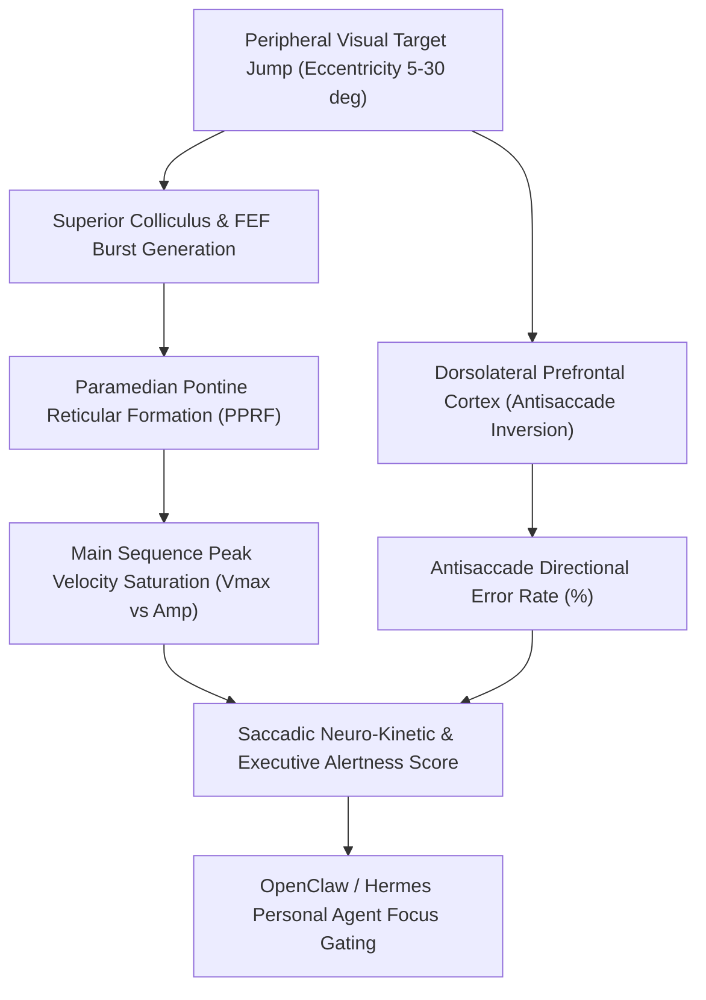

# Oculomotor Saccadic Main Sequence Skill

[](LICENSE)
[](https://www.python.org/)
[](requirements.txt)
[](mcp_server.py)
[](SKILL.md)

Zero-dependency sovereign personal agent skill for non-invasive evaluation of Oculomotor Saccadic Main Sequence peak velocity saturation, reaction latency, antisaccade directional error rate, and frontal executive inhibitory control.



## Features
- **Deterministic Math**: Pure Python standard library implementation with zero external dependencies.
- **Oculomotor Electrophysiology Standards**: Formulates Bahill exponential saturation main sequence curves, latency distribution, and antisaccade inhibition.
- **Cognitive Distractibility & Sedation Screening**: Detects brainstem burst neuron deceleration and loss of prefrontal executive gating.
- **Model Context Protocol (MCP)**: Native JSON-RPC tool integration for LLMs and autonomous agents.

## Quickstart

```python
from client import OculomotorSaccadicMainSequenceClient

client = OculomotorSaccadicMainSequenceClient()
result = client.evaluate_saccadic_kinetics(
    amplitude_deg=10.0,
    peak_velocity_deg_s=335.0,
    latency_ms=205.0
)
print("Main Sequence Ratio:", result["main_sequence_ratio"])
print("Executive Score:", result["saccadic_executive_score"])
print("Classification:", result["classification"])
```

## License
Apache-2.0
